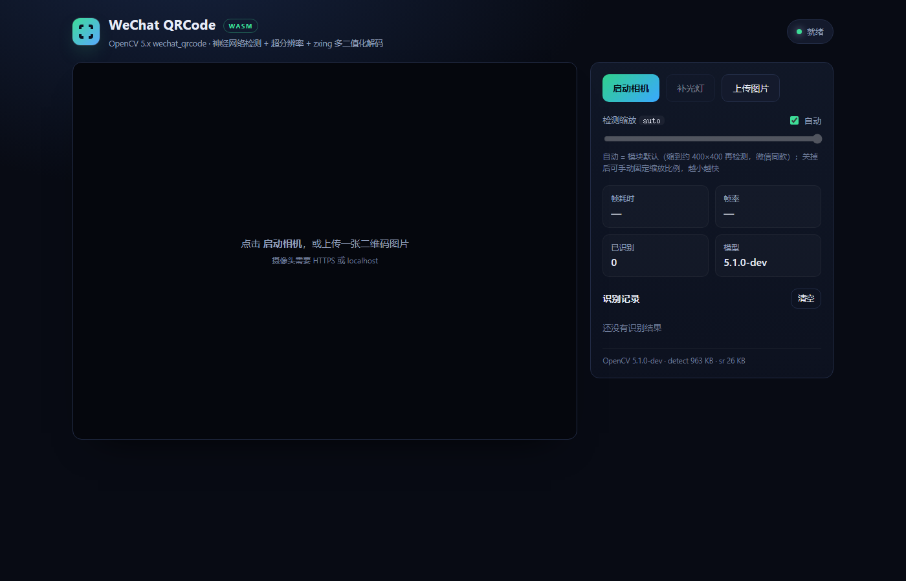

# wechat_qrcode · WebAssembly

[](https://github.com/PPKunOfficial/wechat-qrcode-wasm/actions/workflows/ci.yml)
[](https://github.com/PPKunOfficial/wechat-qrcode-wasm/releases)
[](LICENSE)
[](dist/wq.wasm)
[](package.json)

把 **OpenCV 5.x 的 `wechat_qrcode` 模块**（微信扫码同款算法：SSD 神经网络检测 + 超分辨率 + zxing 多二值化解码）完整编译成 WebAssembly，供前端在浏览器 / Web Worker / Node 中调用。没有原生插件、没有 ONNX Runtime：推理跑在 OpenCV 自己的 `dnn` 模块里，纯 WASM。

- 上游代码路径保持原样（`third_party/opencv_modules/wechat_qrcode` 是从 opencv_contrib 5.x 迁入的副本，只改 CMakeLists 与一个模型补丁，见 [与上游的差异](#与上游的差异)）。
- 官方 ONNX 模型随仓库提供：`models/detect.onnx`（985 KB）+ `models/sr.onnx`（26 KB）。
- 单线程构建：不需要 `SharedArrayBuffer`、不需要 COOP/COEP 响应头，任何静态托管都能跑，也能放进 Worker。
- 提供 demo 摄像头扫码页、Node 准确率基准（对比 zxing-wasm / jsQR）、浏览器端自动化验证。

> 本仓库不是 opencv.js 的封装。opencv.js 不包含 `wechat_qrcode`，而这里编译了它依赖的 `core/imgproc/flann/geometry/dnn` 与模块本体，并用一份精简的 C API（`src/wq_wasm.cpp`）替代 opencv.js 的绑定层。

## 效果

同一份测试集（`tests/assets`，共 33 张，其中 29 张单码：干净参考集 + 刻意刁钻的 hard 档：远景小码、失焦、夜景、眩光、强透视、二次压缩），三个解码器吃完全相同的 RGBA 像素：

| 解码器 | 总体 | 干净集 | hard 档 | 平均耗时（Node） |
| --- | --- | --- | --- | --- |
| **本仓库 wechat_qrcode（tiles=2）** | **28/29 (97%)** | **5/5** | **9/10** | 95 ms |
| 本仓库 wechat_qrcode（默认，不切图） | 27/29 (93%) | 5/5 | 8/10 | 78 ms |
| zxing-wasm（tryHarder + tryRotate + tryDownscale） | 25/29 (86%) | 5/5 | 6/10 | 4.0 ms |
| jsQR | 25/29 (86%) | 5/5 | 6/10 | 83 ms |

完整逐图结果见 [BENCHMARK.md](BENCHMARK.md)（`npm run bench` 可复现）。

要点：

- **hard 档差距即微信算法价值所在**：`hard_url_far_blur`（50px 小码 + 模糊）、`hard_text_zh_defocus`（失焦 2.8）、`hard_long_night`（亮度 ×0.22 + 噪声）这三种图 zxing/jsQR 全灭，wechat_qrcode 全部解出。
- 唯一三边都没解出的是 `hard_text_zh_recompressed`（先缩到 0.35 再模糊再加噪声，已超出可恢复信息量），保留在基准里作为"极限"参照。
- **多码同时识别**：一帧里的多个二维码一次调用全部返回（`count` / `results[]`），检测与解码都是上游本来就支持的路径。实测 2 码 / 3 码 / 同码重复 / 3×3 九宫格（1600×1100）全部完整返回，耗时仍 ~60 ms（9 码 ~70 ms）。回归测试见 `npm test` 的 multi-code 段。
- 浏览器端自动化验证（真实 Chrome，`npm run test:browser`）：**14/14** 通过（含 2 码、3 码场景），单帧 57–65 ms（`hard_url_far` 走 4 块切图兜底，274 ms）。
- 产物体积：`wq.wasm` **4.17 MB**（gzip 0.97 MB）+ `wq.js` 70 KB。体积是构建期裁掉用不到的 dnn 层换来的，`-O3` 与单帧耗时均保持不变（见[体积](#体积)）。两个模型共 1 MB。



## 体积

`dist/wq.wasm` **4.17 MB**（gzip 0.97 MB）+ `dist/wq.js` 70 KB，模型共 1 MB。构建是速度优先的 `-O3`；体积靠**裁掉用不到的 dnn 层**换来，机器码质量与单帧耗时都不受影响（~70 ms vs 未裁剪的 ~71 ms）。准确率：默认 27/29、`tiles: 2` 时 28/29（干净集 5/5，hard 档 8/10 → 9/10），浏览器 14/14。

### 体积是怎么省下来的

**dnn 层裁剪（默认构建，省 ~3.4 MB，速度不变）**：OpenCV `dnn` 在 `modules/dnn/src/init.cpp` 里把 200 多个层的实现用函数指针注册进工厂。函数指针表让链接器无法判断哪些层真正被用到，所以哪怕开了 `--gc-sections`，每个层的实现都还在 wasm 里（实测 7.80 MB 里 `dnn` 占 6.2 MB，而扫码只用得上 14 种层）。构建时 [tools/trim_dnn_registry.py](tools/trim_dnn_registry.py) 把用不到的 209 条注册注释掉，链接器就能把对应 `.o` 排除，wasm 从 7.80 MB 降到 **4.37 MB**，`-O3` 不变、速度不变。

裁剪的代价是"只支持这 14 种层"：本仓库的 `detect.onnx`（Conv/Relu/Add/PriorBox/DetectionOutput/…）和 `sr.onnx`（Conv/LeakyRelu/ConvTranspose/Slice/…）刚好覆盖。要用别的 ONNX 网络就把 `tools/trim_dnn_registry.py` 的 `KEEP` 里加上缺的类型（报错信息会直接给出层名），或者用 `-FullDnn` 构建未裁剪版本（7.44 MB，支持任意 OpenCV dnn 能导入的模型）。

> 也试过用 `-Os` 再压体积：只能从 4.17 MB 降到 3.29 MB（gzip 0.97 → 0.77 MB），单帧却慢约 45%（70 → 101 ms）。扫码是实时交互场景，这个交换不划算，所以不发布小体积版。

细节（裁剪原理、如何重新生成 `KEEP` 列表、`-FullDnn` 全量构建）见 [docs/build.md](docs/build.md#dnn-层裁剪)。

## 快速开始

```bash
npm install          # 仅测试/基准需要（puppeteer-core、zxing-wasm、jsqr）
npm run serve        # http://127.0.0.1:5173/demo/
```

打开 <http://127.0.0.1:5173/demo/> 点「启动相机」，或「上传图片」传一张二维码照片。摄像头需要 HTTPS 或 localhost。

`dist/` 里已带好构建产物（`wq.js` / `wq.wasm`），克隆即可用；重新构建见 [docs/build.md](docs/build.md)。

不想拉整个仓库：到 [Releases](https://github.com/PPKunOfficial/wechat-qrcode-wasm/releases) 下载 `wq.wasm` + `wq.js`（4.17 MB），模型文件在仓库的 `models/` 下（`detect.onnx` / `sr.onnx`，共约 1 MB）。

### 作为库使用

```js
import { createScanner } from './web/scanner.js';

const scanner = await createScanner({
  detectModel: '/models/detect.onnx',
  srModel: '/models/sr.onnx',       // 可省略：省略则关闭神经网络超分辨率
});

// ImageData / {data,width,height,format} / canvas / video / ImageBitmap /  均可
const { count, results, ms } = scanner.scan(imageData, { tiles: 2 });
for (const { text, points } of results) {
  console.log(text, points);        // points = 4 个角点 [[x,y],...]
}
scanner.destroy();
```

`results` 是数组：同一帧里的多个二维码会全部返回（顺序不保证，`points` 是每个码的 4 个角点）。重复内容的两个码会作为两条独立结果返回（上游去重是"空间距离 < 10px"，不是按文本）。

`tiles: 2` 打开重叠切图兜底：整图先扫一次，扫不到才把图切成 2×2 重叠块再扫（并回填坐标）。手机的远距离小码场景用它；实时预览建议保持默认（不切图，单帧 ~60 ms）。

API 细节（`scan` / `scanGray` / `scanImageURL` / 输入格式 / `scaleFactor`）见 [docs/api.md](docs/api.md)。

## 仓库结构

```
src/wq_wasm.cpp                 C API：wq_init / wq_scan / wq_result_json / …
web/scanner.js                  ESM 封装（模型注入 MEMFS、扫描、切图兜底、结果解析）
dist/wq.js, dist/wq.wasm        预编译产物
models/detect.onnx              官方检测模型（未修改）
models/sr.onnx                  官方超分模型（修正了动态尺寸裁剪，见 tools/patch_sr_model.py）
third_party/opencv_modules/     从 opencv_contrib 5.x 迁入的 wechat_qrcode 源码（改动见同目录 UPSTREAM.md）
scripts/                        取源码 / 配置 / 编译 OpenCV 与 wasm / 静态服务器
demo/                           摄像头扫码 demo
tests/                          Node 测试、基准、浏览器自动化验证、生成的测试图
tools/                          模型下载、SR 模型修补、测试集生成、dnn 层裁剪
docs/                           构建、架构、API 文档
.github/workflows/ci.yml        CI：生成测试集 → 准确率 → 基准 → 真实 Chrome 验证
NOTICE / THIRD_PARTY_NOTICES    归属声明与第三方许可
CONTRIBUTING.md                 贡献指南
```

## 自己构建

需要：Node ≥ 18、Python 3、CMake ≥ 3.5、Ninja、[emsdk](https://github.com/emscripten-core/emsdk)（Emscripten 6.x）、OpenCV 5.x 源码。

```powershell
# 1. 准备 OpenCV 5.x 源码（或设 $env:OPENCV_SRC 指向已有 checkout）
.\scripts\fetch-opencv.ps1

# 2. 用 emscripten 交叉编译 OpenCV 静态库（core/imgproc/flann/geometry/dnn/wechat_qrcode）
#    默认会裁剪 dnn 层注册（体积 7.80 → 4.37 MB）；加 -FullDnn 保留完整注册
.\scripts\configure-opencv.ps1
.\scripts\build-opencv.ps1

# 3. 链接 wasm 模块
.\scripts\build-wasm.ps1

```

细节、耗时、坑（模块白名单缓存、`opencv5` 安装目录、`liblibprotobuf.a`、ONNX 模型动态尺寸）见 [docs/build.md](docs/build.md)。

## 与上游的差异

1. **CMakeLists**：去掉未使用的 `opencv_objdetect` 依赖和 `WRAP java objc python js`，去掉 5.x 里已经失效的 caffe 模型下载块（5.x 只读 ONNX）。逐条记录见 [third_party/opencv_modules/wechat_qrcode/UPSTREAM.md](third_party/opencv_modules/wechat_qrcode/UPSTREAM.md)。
2. **`models/sr.onnx` 打了动态尺寸补丁**：原模型把 Caffe `Crop` 层固化成 `Slice(ends=[447,447])`，只在 224×224 输入时成立；本模块会喂任意大小的二维码裁剪图。补丁把 `ends` 改成 `[-1,-1]`、输入输出维度改成符号维度（`tools/patch_sr_model.py`，可重复生成）。`models/detect.onnx` 未修改——OpenCV 5.x 的 `Reshape2` 已有旧模型兼容逻辑，能跑动态尺寸。
3. **OpenCV 以 `-DOPENCV_HAVE_FILESYSTEM_SUPPORT=1` 编译**：Emscripten 下 OpenCV 默认关闭文件系统，而 `WeChatQRCode` 构造函数会 `CV_Assert(utils::fs::exists(model_path))`。打开后模型通过 Emscripten MEMFS 按路径加载。
4. **JS 侧切图兜底**：检测网络总是把整帧缩放到 ~400×400，大图里的小码会小到检测不到；`scanner.scan(..., { tiles: 2 })` 用重叠切图恢复小码的相对尺寸。这是对上游能力的补充，默认关闭，不影响原算法路径。
5. 不编译 `objdetect/calib3d/features2d/highgui/videoio/imgcodecs`，以控制 wasm 体积。
6. **构建期裁剪 dnn 层注册**：`tools/trim_dnn_registry.py` 改写 OpenCV checkout 里的 `modules/dnn/src/init.cpp`（保留本仓库两个模型用到的 14 种层），让链接器丢掉用不到的层实现，wasm 7.80 → 4.37 MB 且速度不变；`build-opencv.ps1 -FullDnn` 可跳过裁剪。

## 已知限制

- 单线程：一帧约 60–70 ms（640×480–1280×720），适合 10–15 fps 的扫码预览；需要更高帧率时应在 Worker 里跑，并把画面降到 640×480。
- 可选切图兜底会使最坏耗时到 ~300 ms（1600×1200 分 4 块），适合拍照/上传，不适合实时视频。
- wasm 未启用 SIMD（浏览器覆盖率考虑），开 `-msimd128` 可再快一些，但会要求较新的浏览器。
- 5.x 分支是开发版（`OpenCV 5.1.0-dev`）；上游若改动了 ONNX 导入器行为需重新验证。
- 默认构建裁剪了 dnn 层注册（只保留两个模型用到的 14 种层），加载其它 ONNX 网络会报 `layer not found`；需要通用推理时用 `-FullDnn` 构建。
- 极低信息量的图（如二次压缩 + 强噪声）任何解码器都无解，属正常。

## 许可与归属

本仓库原创部分（C API、JS 封装、构建脚本、测试、文档）以 **Apache License 2.0** 发布，见 [LICENSE](LICENSE)。随仓库分发的第三方组件与模型沿用其原有许可：

| 组件 | 许可 |
| --- | --- |
| OpenCV 5.x（`core/imgproc/flann/geometry/dnn`，静态链接进 `dist/wq.wasm`） | Apache-2.0 |
| opencv_contrib `wechat_qrcode` 模块（含 ZXing C++ 移植） | Apache-2.0，`Copyright (C) 2021 THL A29 Limited, a Tencent company` |
| `models/detect.onnx` / `models/sr.onnx`（微信二维码检测与超分模型） | Apache-2.0（Tencent，见 [models/LICENSE](models/LICENSE)） |
| Protocol Buffers 3.19.1 / zlib 1.3.2 / HarfBuzz 14.2（wasm 内静态链接） | BSD-3-Clause / zlib / Old MIT |

完整的版权声明、修改说明与各许可全文见 [NOTICE](NOTICE) 与 [THIRD_PARTY_NOTICES.md](THIRD_PARTY_NOTICES.md)；模块原始许可保留在 [third_party/opencv_modules/wechat_qrcode/LICENSE](third_party/opencv_modules/wechat_qrcode/LICENSE)。

本仓库对上游文件的修改（CMakeLists、`models/sr.onnx` 补丁）已按 Apache-2.0 §4(b) 在上表与 `UPSTREAM.md` 中标注。

> **商标声明**：WeChat / 微信是腾讯的商标。本项目是独立的社区移植，与腾讯、OpenCV、ZXing 作者无隶属关系，也未获其背书；名称仅用于说明算法与模型来源。
